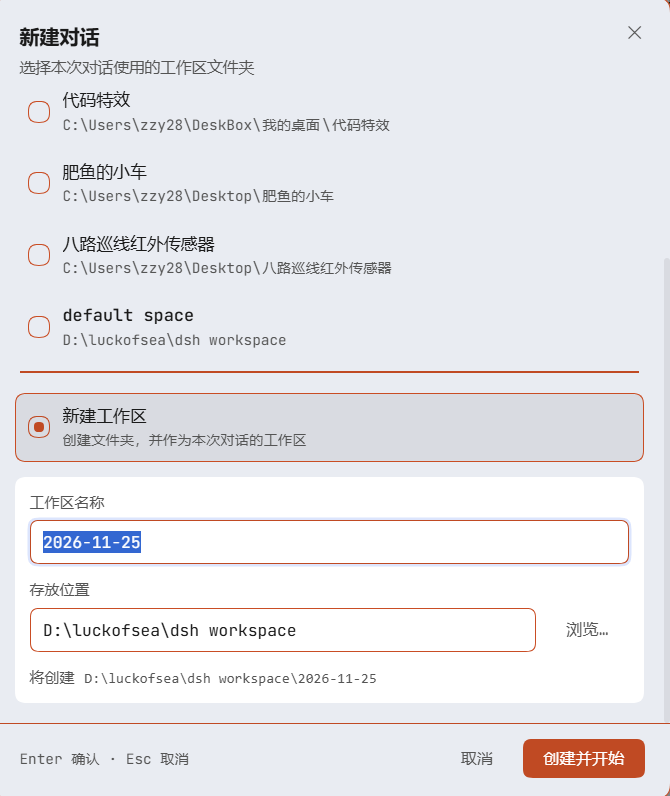

# dsh-new-session-workspace

[中文说明](README.zh.md) · [详细说明](docs/DETAIL.md)

Ask which folder a new chat belongs in, right when you start it.



Every way of starting a DSH conversation — `Ctrl+N`, the **New session** row at the top of the sidebar, the expanded brand mark, and the `+` buttons of sidebar-replacing plugins — goes through the same unscoped `uiWorkspace.startSession()`. This plugin intercepts that single call and asks first:

- **Existing workspaces** — pick from every Workspace registered in the profile (title + absolute path); the one holding the current session is preselected.
- **New workspace** — name it inline, defaulting to today's date (`YYYY-MM-DD`), choose the parent folder (typed, or via **Browse…**), and watch the resulting path preview update. The plugin creates the folder, registers it as a Workspace, and opens a blank conversation there.

Cancel with the button, `Esc`, or a backdrop click and nothing is created — no session, no folder.

## Install

From the DSH plugin manager, or from a checkout:

```text
plugin_manager install_bundle { "target": "file:<absolute path to this directory>" }
```

Requires DSH `>=0.2.0-rc.1 <0.3.0-0`.

## How it works

The browser half monkey-patches the live `uiWorkspace` service: calls with an explicit workspace id pass through untouched, unscoped calls open the dialog instead, and confirming replays the saved original method with the chosen id. The dialog is registered in the `shell.overlay` slot, so it coexists with plugins that replace `sidebar.workspaces`.

The Host half exists because on Windows and macOS Desktop the folder picker is the **native** capability (only `pick()`), while `workspaceRegistry.create()` refuses paths that do not exist yet. It exposes two same-origin JSON routes:

| Route | Behaviour |
| --- | --- |
| `POST /dsh-new-session-workspace/prepare` | validate `{ parent, name }`, create the directory recursively, return `{ ok: true, path }` |
| `POST /dsh-new-session-workspace/home` | return `{ ok: true, home }` as the fallback location |

Both require `content-type: application/json` and reject cross-origin requests.

## Files

- `dist/index.js` — Host half: the folder routes.
- `dist/client.js` — browser half: the `startSession` patch, dialog, styles.
- `cordis.patch.yml` — inserts the `new-session-workspace` Loader row.
- `dsh.plugin.json`, `package.json`, `locale/*.json` — manifests and plugin-manager copy.
- `docs/DETAIL.md`, `docs/DETAIL.zh.md` — longer write-ups shown from the plugin manager.

After editing `dist/index.js`, reload the Host half by disabling and re-enabling the bundle, or restart the app. `dist/client.js` follows a normal page reload.

## License

[GPL-3.0](LICENSE)
