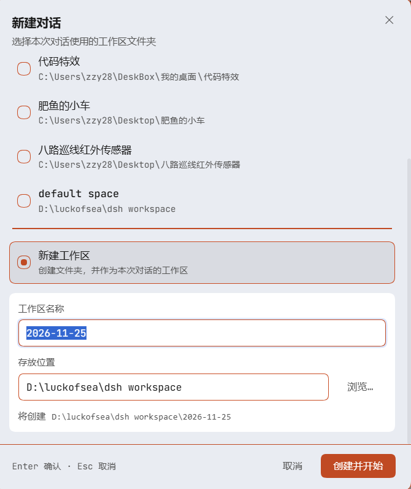

# dsh-new-session-workspace

[English](README.md) · [详细说明](docs/DETAIL.zh.md)

开始新对话的那一刻，先问一句「这次在哪个目录」。



所有开启新对话的入口——`Ctrl+N`、侧边栏顶部的**新会话**行、展开的 brand 图标，以及替换侧边栏的插件（如 `dsh-workspace-plus`）的 `+` 按钮——最终都调用同一个不带参数的 `uiWorkspace.startSession()`。本插件只拦截这一个调用：

- **现有工作区**：列出 profile 里注册的全部工作区（名称 + 绝对路径），默认选中当前会话所在的那个。
- **新建工作区**：内联填写名称（默认当天日期 `YYYY-MM-DD`），选择存放位置（手动输入或点**浏览…**调用系统选择器），下方实时预览最终路径；确认后插件创建文件夹、注册工作区，并在其中打开一个空白对话。

取消（按钮、`Esc`、点击遮罩）不会创建任何东西：既不建文件夹，也不开新会话。

## 安装

在插件管理器里安装，或在本地目录使用：

```text
plugin_manager install_bundle { "target": "file:<本目录的绝对路径>" }
```

要求 DSH `>=0.2.0-rc.1 <0.3.0-0`。

## 实现方式

浏览器半个给运行中的 `uiWorkspace` 服务打补丁：带工作区 id 的调用原样透传，不带 id 的调用改为弹出对话框；确认后调用被保存的原始方法，并传入所选工作区 id。对话框注册在 `shell.overlay` 槽位，因此能与替换 `sidebar.workspaces` 的插件共存。

宿主半个存在的原因：Windows / macOS 桌面端的文件夹选择器是 **native** 能力（只有 `pick()`），而 `workspaceRegistry.create()` 又拒绝不存在的路径。于是宿主半个提供两个同源 JSON 路由：

| 路由 | 行为 |
| --- | --- |
| `POST /dsh-new-session-workspace/prepare` | 校验 `{ parent, name }`，递归创建目录，返回 `{ ok: true, path }` |
| `POST /dsh-new-session-workspace/home` | 返回 `{ ok: true, home }`，作为「位置」的兜底 |

两个路由都要求 `content-type: application/json`，并拒绝跨源请求。

## 文件

- `dist/index.js` — 宿主半个：目录路由。
- `dist/client.js` — 浏览器半个：`startSession` 补丁、对话框、样式。
- `cordis.patch.yml` — 插入 `new-session-workspace` loader 行。
- `dsh.plugin.json`、`package.json`、`locale/*.json` — 清单与插件管理器文案。
- `docs/DETAIL.md`、`docs/DETAIL.zh.md` — 插件管理器里展示的详细说明。

修改 `dist/index.js` 后，需要在插件管理器里停用再启用该 bundle（或重启桌面端）让宿主半个重新加载；`dist/client.js` 跟随普通页面刷新。

## 许可

[GPL-3.0](LICENSE)
