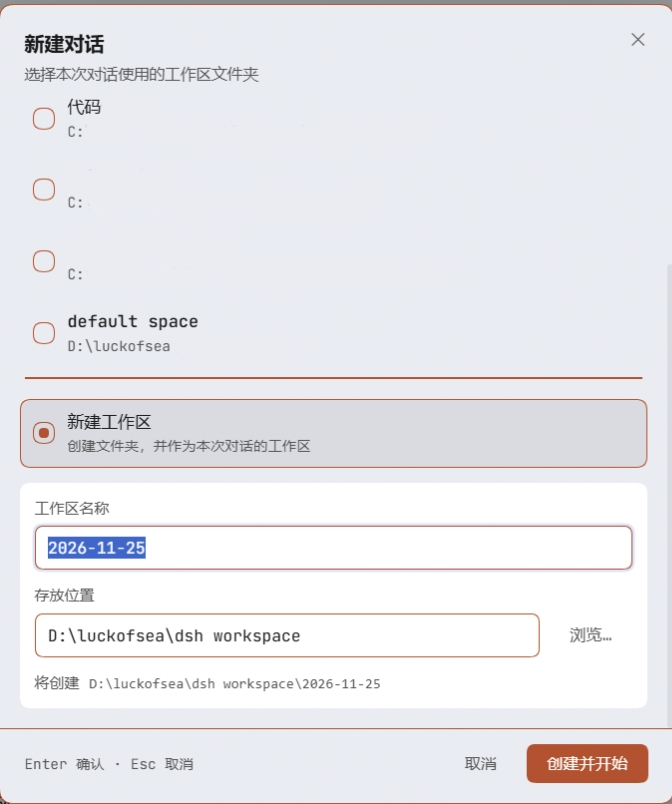

# Pick a workspace before a new chat starts

Every entry point that opens a new DSH conversation — `Ctrl+N`, the **New session** row at the top of the sidebar, the expanded brand mark, and the `+` buttons added by workspace-replacing plugins — goes through the Host's unscoped `uiWorkspace.startSession()`. This plugin patches that one call: an explicit workspace id passes straight through, while an unscoped call opens a dialog instead.

## What the dialog offers

- **Existing workspaces** — every Workspace registered in the profile, with its title and absolute path. The one holding the current session is preselected.
- **New workspace** — an inline form:
  - **Name** defaults to today's date (`YYYY-MM-DD`) and is fully editable.
  - **Location** defaults to the parent folder of the current workspace, or the last folder you used. Type it, or press **Browse…** to open the OS folder picker.
  - The created folder is shown as a live preview of the final path.

**Start** registers the chosen Workspace and opens a blank conversation in it. Cancelling (button, `Esc`, clicking the backdrop) creates nothing at all.

## Why it ships a Host half

On Windows and macOS the Desktop folder picker is the **native** capability: `capability().kind === 'native'` exposes only `pick()`. `createDirectory()` and `listDirectory()` belong to the separate *browse* capability, which this install does not mount. At the same time `workspaceRegistry.create()` refuses any path that does not exist yet.

So the Host half registers two same-origin JSON routes:

| Route | Behaviour |
| --- | --- |
| `POST /dsh-new-session-workspace/prepare` | validates `{ parent, name }`, creates `parent/name` recursively, returns `{ ok: true, path }` |
| `POST /dsh-new-session-workspace/home` | returns `{ ok: true, home }`, used as the fallback location when no workspace exists yet |

Both routes require `content-type: application/json` and reject cross-origin requests. The browser half calls them with a same-origin `fetch`, so page authentication still applies.

The full flow is `prepare` → `workspaces.create({ path })` → the saved original `startSession(workspaceId, options)`.

## Good to know

- Works with plugins that replace `sidebar.workspaces` (such as `dsh-workspace-plus`): the dialog lives in `shell.overlay`, not in the sidebar.
- After changing `dist/index.js`, reload the Host half by disabling and re-enabling the bundle in the plugin manager, or restart the app. `dist/client.js` follows a normal page reload.
- Requires DSH `>=0.2.0-rc.1 <0.3.0-0`.
