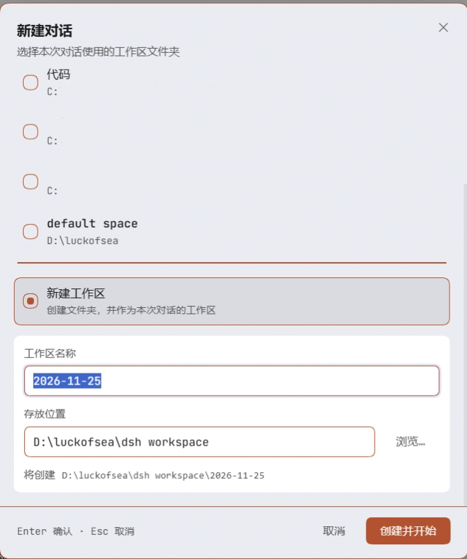

# 新对话开始前先选工作区

在 DSH 客户端里，所有「无参新会话」入口——`Ctrl+N`、侧边栏顶部的**新会话**行、展开的 brand 图标，以及替换侧边栏的插件（如 `dsh-workspace-plus`）自带的 `+` 按钮——最终都调用宿主同一个 `uiWorkspace.startSession()`。本插件只改这一个调用：带工作区 id 的照常透传，不带 id 的改为先弹出对话框。

## 对话框能做什么

- **现有工作区**：列出当前 profile 里注册的全部工作区（名称 + 绝对路径），默认选中当前会话所在的那个。
- **新建工作区**：内联表单
  - **名称**默认填入当天日期（`YYYY-MM-DD`），可以随意修改；
  - **位置**默认是当前工作区所在目录，或你上次使用过的目录；可直接输入，也可点**浏览…**调用系统文件夹选择器；
  - 表单下方实时预览最终创建的完整路径。

点**开始对话**后，插件注册该工作区并在其中打开一个空白会话；取消（按钮、`Esc`、点击遮罩）不会创建任何东西。

## 为什么需要宿主半个

Windows / macOS 桌面端的宿主文件夹选择器是 **native** 能力：`capability().kind === 'native'` 只提供 `pick()`。`createDirectory()` 和 `listDirectory()` 属于另一种 *browse* 能力，这台机器上没有挂载。而 `workspaceRegistry.create()` 又拒绝任何尚不存在的路径。

所以宿主半个注册了两个同源 JSON 路由：

| 路由 | 行为 |
| --- | --- |
| `POST /dsh-new-session-workspace/prepare` | 校验 `{ parent, name }`，递归创建 `parent/name`，返回 `{ ok: true, path }` |
| `POST /dsh-new-session-workspace/home` | 返回 `{ ok: true, home }`，在没有工作区时给「位置」兜底 |

两个路由都要求 `content-type: application/json`，并拒绝跨源请求；浏览器半个用同源 `fetch` 调用，认证沿用页面会话。

完整流程：`prepare` 建目录 → `workspaces.create({ path })` 注册 → 用被保存的原始 `startSession(workspaceId, options)` 打开新对话。

## 补充说明

- 与替换 `sidebar.workspaces` 的插件（例如 `dsh-workspace-plus`）兼容：对话框挂在 `shell.overlay` 上，不依赖侧边栏实现。
- 修改 `dist/index.js` 后，需要在插件管理器里停用再启用该 bundle（或重启桌面端）让宿主半个重新加载；`dist/client.js` 跟随普通页面刷新。
- 要求 DSH `>=0.2.0-rc.1 <0.3.0-0`。
